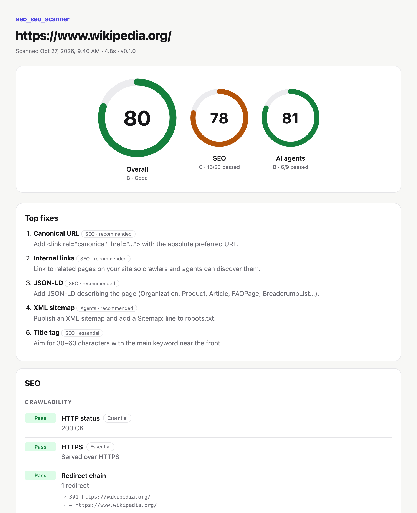

# aeo_seo_scanner

**AEO + SEO in one scan: is your page findable by search engines *and* AI answer engines?**

Give it a URL and it scores the page 0–100 on two things:

- **SEO**: the on-page fundamentals Google checks (titles, H1s, canonicals, links, structured data and more).
- **AEO / AI agent readiness**: whether ChatGPT, Claude, Perplexity and AI browser agents can reach, read and cite the page.

You get a letter grade for each, the five fixes that matter most, and the evidence behind every result.



## Quick start for SEOs

No coding needed, just one command in your computer's terminal.

**1. Install Node.js (one time).** Download the **LTS** version from [nodejs.org](https://nodejs.org/en/download) and run the installer. If you use Homebrew on a Mac, `brew install node` does the same.

**2. Open Terminal** (Mac: press <kbd>⌘</kbd> + <kbd>Space</kbd> and type "Terminal". Windows: open "PowerShell".)

**3. Scan a page.** Paste this, replacing `example.com` with any page you like:

```sh
npx github:JopetLL/aeo_seo_scanner example.com --html
```

The first run asks "Ok to proceed?" (type `y`) and takes about 30 seconds to install. After that, scans take 2–10 seconds. The scores print in the terminal, and `--html` also saves a shareable report (like the one above) in the folder you ran it from. On a Mac, `open aeo_seo_scanner-*.html` opens it. In the report, hover the **?** next to any category or check to see what it looks at and why it matters.

### What the scores mean

| Score | Grade | What it means |
|---|---|---|
| 90–100 | A / A+ | Solid. Any remaining fixes are polish. |
| 80–89 | B | Good, with a few gaps worth fixing this quarter. |
| 70–79 | C | Fair. Something important is missing, usually schema, canonicals or metadata. |
| 60–69 | D | Needs work. Search engines or AI agents are likely misreading the page. |
| < 60 | F | Poor. Fundamentals are missing, or AI agents can't read the content at all. |

- **SEO** covers what search engines need to crawl, understand and rank the page.
- **Agents** covers what AI assistants need to fetch, read and cite it. Most AI agents don't run JavaScript, so content that only appears after scripts run counts as missing.
- **Overall** is the average of the two.
- Start with **Top fixes**: they're already ranked by impact, with essential checks first.
- **Tags & tracking** lists the analytics, ad and marketing tools a page runs, including those configured inside Google Tag Manager. It's handy for seeing a competitor's stack.

### What it finds in practice

Real findings from scans of live sites:

- **A photography marketplace's homepage title and meta description are both just its brand name.** Google gets no hint of what the company does.
- **A staffing company's Organization schema was silently invalid** because a line break had crept into the middle of the logo URL. Google ignores the whole block, including the brand, address and contact details AI answers draw on.
- **A popular web app's homepage is an empty JavaScript shell.** AI agents see one word of content.
- **A site that redirects every missing page to its homepage**, which search engines treat as a soft 404, and which misleads agents that follow a dead link.
- **A Google Tag Manager container still configured with two retired Universal Analytics properties** next to GA4, Google Ads, LinkedIn and Bing tags, in a 631 KB container.

## Use it from Claude Code

This repo includes a Claude skill. Link it into your skills folder once:

```sh
git clone https://github.com/JopetLL/aeo_seo_scanner.git
ln -s "$PWD/aeo_seo_scanner/skills/aeo-seo-scanner" ~/.claude/skills/aeo-seo-scanner
```

Then ask Claude things like *"scan example.com"* or *"compare our pricing page with competitor X's"*. Claude runs the scanner, checks suspicious results against the live page, and explains the fixes.

## Why

Agent-readiness scanners such as [Is Agentic](https://is-agentic.com) and Cloudflare's [isitagentready.com](https://isitagentready.com) check whether AI agents can use a site. SEO auditors check whether Google can rank it. In practice they're the same job: the page needs to be crawlable, server-rendered, well-structured and clearly labelled. `aeo_seo_scanner` checks both in one pass, runs locally with no account or API key, and works as a CI gate.

## Install for developers

Requires Node 20 or later.

```sh
npx github:JopetLL/aeo_seo_scanner <url>       # run straight from GitHub
npm install -g github:JopetLL/aeo_seo_scanner  # or install the aeo_seo_scanner command globally
```

## Usage

```sh
aeo_seo_scanner example.com                        # terminal report
aeo_seo_scanner https://example.com/pricing --html # also write aeo_seo_scanner-example.com.html
aeo_seo_scanner example.com --json | jq .overall   # machine-readable
aeo_seo_scanner example.com --fail-under 80        # exit 1 below 80, for CI
```

| Option | |
|---|---|
| `--json` | Print the full report as JSON |
| `--html` | Also write a self-contained HTML report |
| `--out <file>` | HTML report path (default `aeo_seo_scanner-<host>.html`) |
| `--no-links` | Skip checking whether links resolve (faster) |
| `--max-links <n>` | Check at most *n* links (default 50) |
| `--timeout <ms>` | Per-request timeout (default 15000) |
| `--fail-under <n>` | Exit with code 1 if the overall score is below *n* |
| `-v`, `--verbose` | Show every evidence line |

Exit codes: `0` success, `1` below `--fail-under`, `2` the page could not be scanned.

## What it checks

### SEO

| Category | Check | Tier |
|---|---|---|
| Crawlability | HTTP 200 · HTTPS · noindex (meta and `X-Robots-Tag`) · Googlebot/Bingbot allowed by robots.txt | Essential |
| | Redirect chain length · canonical tag (present, absolute, self-referencing) | Recommended |
| Metadata | `<title>` present and 30–60 chars | Essential |
| | Meta description 70–160 chars · `lang` · viewport · Open Graph | Recommended |
| | Twitter/X card · favicon | Minor |
| Content | Exactly one non-empty H1 | Essential |
| | 300+ words · image alt coverage | Recommended |
| | Heading hierarchy with no skipped levels | Minor |
| Links | Internal link count · broken links (HEAD, falling back to GET) | Recommended |
| | Empty or generic anchor text ("click here", "learn more") | Minor |
| Structured data | Valid JSON-LD, with the schema types listed | Recommended |
| Performance | Response time · HTML size | Minor |
| Tags & tracking | Inventory of analytics, ad, marketing, consent and verification tags, from the HTML and from public Google Tag Manager containers (IDs such as `G-…`, `AW-…`, `GTM-…`, and the Custom HTML tag count) | Info |
| | Warnings only: retired Universal Analytics still installed · GA4 both hard-coded and in GTM · tracking with no consent manager · 8+ tracking vendors or a GTM container over 500 KB | Minor |

### AI agent readiness

| Category | Check | Tier |
|---|---|---|
| Access | robots.txt rules for AI **search and answer** agents (OAI-SearchBot, ChatGPT-User, Claude-SearchBot, Claude-User, PerplexityBot…) | Essential |
| | The page actually returns 200 to AI user-agents, which catches WAF/CDN bot blocking | Essential |
| | Unknown URLs return 404, not a soft 404 | Recommended |
| Understanding | Main content is in the initial HTML, without running JavaScript; empty app shells are detected | Essential |
| | `<main>` and other landmarks · citation metadata (canonical, title, publisher, language, image) · labelled form controls and buttons | Recommended |
| Discovery | robots.txt · XML sitemap | Recommended |
| Emerging | `llms.txt` · Markdown via `Accept: text/markdown` · Content Signals · API catalog (RFC 9727) · MCP / agent-skill discovery under `/.well-known/` | Bonus |

Blocking **training** crawlers (GPTBot, ClaudeBot, Google-Extended, CCBot…) is reported but never penalised. It's a legitimate business decision, and it doesn't stop a site from being cited in AI answers.

## Scoring

Each pillar is a weighted share of the points available:

- **Essential** checks are worth 3, **recommended** 2 and **minor** 1.
- A **pass** earns full credit, a **warning** half credit and a **fail** none.
- Checks that don't apply (no images, no forms) are left out rather than counted as passes or failures. The tag inventory never affects the score; only its four warnings can, as minor checks.
- **Bonus** checks for emerging standards add 1 point each, up to +5. Their absence never lowers a score, because adoption is still early and their impact is unproven.

The overall score is the average of the SEO and Agents scores.

| Score | Grade |
|---|---|
| 95–100 | A+ · Excellent |
| 90–94 | A · Excellent |
| 80–89 | B · Good |
| 70–79 | C · Fair |
| 60–69 | D · Needs work |
| < 60 | F · Poor |

**Top fixes** ranks the failing and warning checks by their potential impact, so essential failures come first.

## Limitations

- It scans one public URL, as a snapshot. Pages behind a login, results that vary by region, and content added by JavaScript after load are out of scope by design, because most agents can't see those either.
- AI user-agent tests send the published UA strings from a regular IP address. Some firewalls verify bot IP ranges, so a block reported here may not affect the real agent. The report says so when this applies.
- External links that refuse scripted requests (social networks often do) are marked *unverified*, not broken.
- A score is a prioritised technical review. It isn't a ranking guarantee or an accessibility audit.
- Tag detection reads the HTML and public GTM containers. Tags bundled into a site's own JavaScript, served from its own domain, or fired server-side are invisible, and the scan can't tell whether a tag actually fires for a given visitor (that depends on consent and triggers).

## Development

```sh
npm install
npm run dev -- example.com   # run from source (Node 22.6+ strips the TypeScript types)
npm test                     # unit tests (node:test)
npm run build                # compile to dist/
```

The code lives in `src/`. Each check is a small synchronous function in `checks/seo.ts` or `checks/agent.ts` that reads from a `ScanContext`, which `scan.ts` gathers up front, mostly in parallel requests. `robots.ts` is a standalone robots.txt parser that follows RFC 9309 and Google's matching rules.

## License

MIT
